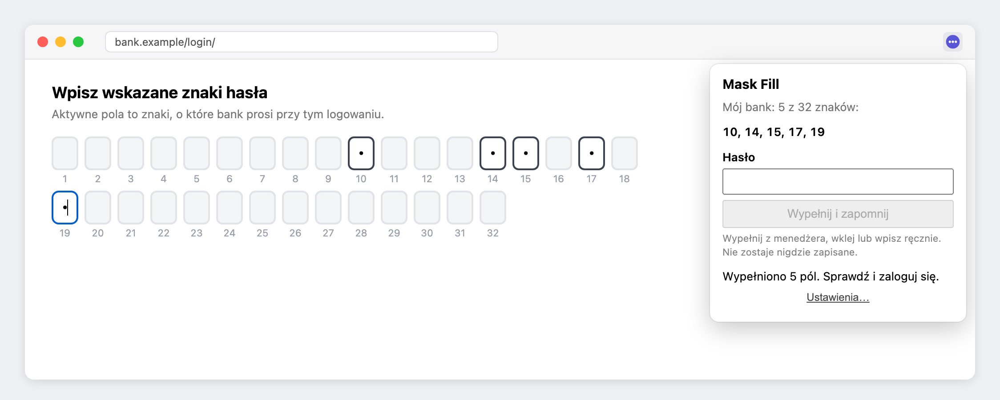
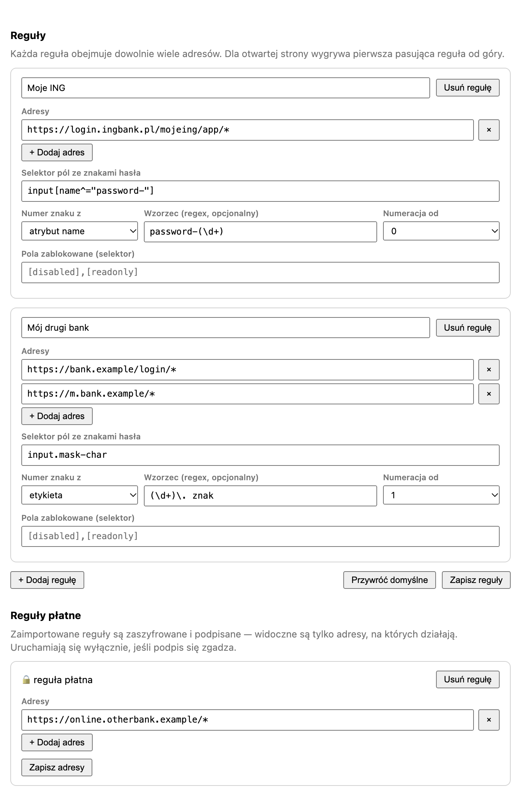

# Mask Fill — Safari Web Extension

Some banks ask for characters at specific positions of your password ("wpisz
wskazane znaki hasła" — e.g. 10, 14, 15, 17, 19 of 32). No password manager can
fill that. This extension can: on an explicit click it types only the characters
the bank is currently asking for, taking the password from your password manager
and keeping nothing.



<!-- TODO: docs/screenshots/demo.gif -- recording of the fill in Safari -->

Ships with a rule for Moje ING and lets you add your own: each rule says which
addresses it covers, how to find the character boxes, and how to read the
position number off them. Rules can also be imported as signed, encrypted
packages whose only readable part is the address they run on. See
**Ustawienia → Reguły**.

## How it works

A Manifest V3 Safari Web Extension in plain JavaScript — no framework, no build
step, no dependencies — wrapped in the macOS container app Safari requires.

- **Nothing is persisted.** The password arrives through macOS autofill (so
  Touch ID gates every use), lives in one local variable in the popup, and only
  the characters for the requested positions ever reach the page. An earlier
  version kept the password in the Keychain; it was removed on purpose, because
  storing a full banking password undercuts the reason masked passwords exist.
- **Detection is data, not code.** The content script knows nothing about any
  bank. It is handed a rule — a CSS selector, where to read each box's position
  from (`name`, `id`, label, printed text or DOM order) and a regex — and
  applies it. Reading the position from an attribute rather than counting boxes
  means a page that omits a box cannot silently shift every other position.

  

- **Real-world markup.** ING renders the widget with Lit inside nested open
  shadow roots, so the content script walks shadow trees to find the inputs. The
  framework also keeps its own copy of each value, so filling goes through the
  native `HTMLInputElement` value setter and dispatches `input`/`change` events.
- **Signed rule packages.** A rule can be shipped as a package whose contents
  are AES-GCM encrypted and signed with ECDSA P-256 (Web Crypto). The signature
  is verified before anything is decrypted, so a rule the extension did not
  sign never runs. The user can still edit which addresses a package covers;
  the signature binds only the contents.
- **Least privilege.** The only static host permission is the ING login path.
  Sites added by the user go through optional host permissions requested per
  site, and content scripts are registered at runtime only for hosts actually
  granted. Filling always requires an explicit click.

## Trade-offs, read before installing

The extension stores nothing: the password goes from your password manager
straight into the boxes and is gone when the popup closes. It is still only as
safe as the Mac it runs on, and automating a bank login may conflict with your
bank's terms of service. Decide knowingly.

Nothing runs automatically and nothing is transmitted anywhere.

## Requirements

- macOS 12.3 or later with Safari 16.4 or later
- Xcode (developed against Xcode 26.2)

## Install

```sh
tools/run.sh
```

Launching the app once registers the extension with Safari. Then:

1. Safari → Settings → Advanced → **Show features for web developers**
2. Safari → Develop → **Allow Unsigned Extensions** (needed for local builds;
   resets every time Safari restarts)
3. Safari → Settings → Extensions → enable **Mask Fill** and grant it access
   to `login.ingbank.pl`
4. Open the masked-password step and fill from your password manager

## Use

On the masked-password step of `login.ingbank.pl/mojeing/app/#login-oauth2`,
click the toolbar button. The popup shows which
positions ING is asking for; press **Wypełnij hasło** and review the boxes before
submitting. Signing in is always left to you.

## Testing without the bank

```sh
tools/test-content.sh
```

Runs headless Chrome over offline fixtures that load the shipped source rather
than copies, so the tests cannot drift from what ships:

- `tools/mock-widget.html` — a replica of ING's Lit widget (shadow roots,
  slotted inputs, disabled boxes) driving the real content script, including
  negative controls proving that a non-piercing query finds nothing and a plain
  `value` assignment never reaches the component.
- `tools/mock-options.html` — mounts the real settings page with stubbed
  extension APIs and exercises rule editing and package import.
- `tools/test-seal.mjs` — signs a rule with the vendor tool and opens it with
  the extension's `seal.js`, and checks that tampered ciphertext and foreign
  signatures are rejected.

Open the HTML fixtures in a browser to see the same checks visually.

## Layout

| Path      | Contents                                                     |
| --------- | ------------------------------------------------------------ |
| `src/`    | the extension — plain HTML/CSS/JS, no build step              |
| `src/crypto/` | public verify key and `seal.js` (verify, then decrypt)    |
| `rules/`  | the ING rule as plaintext source and as a signed package      |
| `xcode/`  | container app Safari requires; the native handler is a stub   |
| `tools/`  | build/run scripts, test fixtures, key and signing tools       |
| `docs/`   | README screenshots, regenerated by `tools/screenshots.sh`     |

## Writing a rule for another site

Open the masked-password step, paste `tools/inspect-widget.js` into the Web
Inspector console, and it prints the widget's structure — attribute names,
which boxes are disabled, where the position number is rendered. It never reads
values, so the output is safe to share. Then add a rule in the settings page;
Safari will ask for access to the new site.

See `CLAUDE.md` for the security model and architecture notes.
